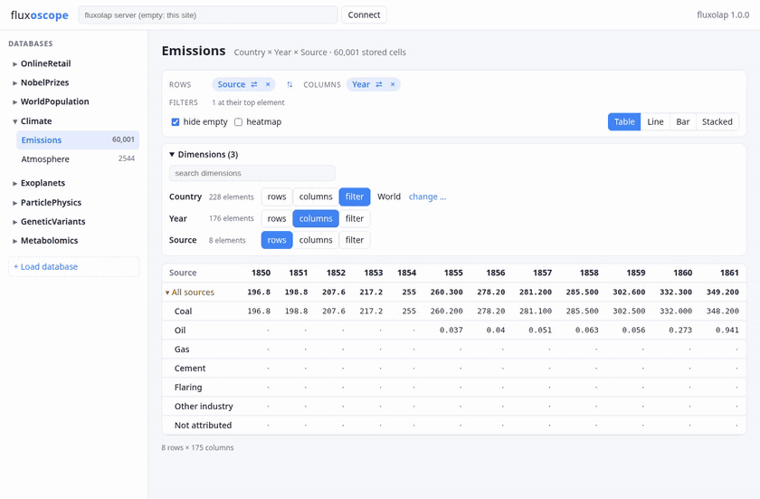
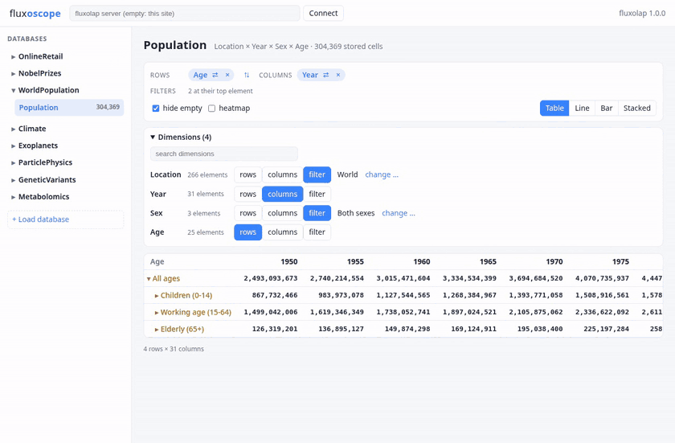
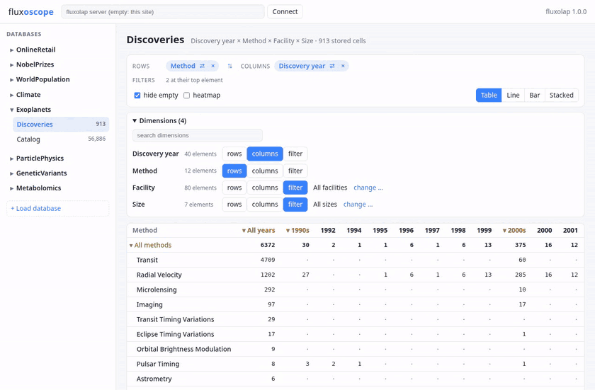
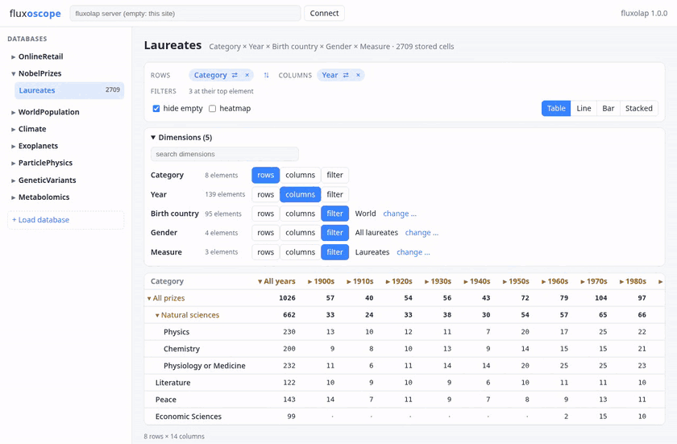
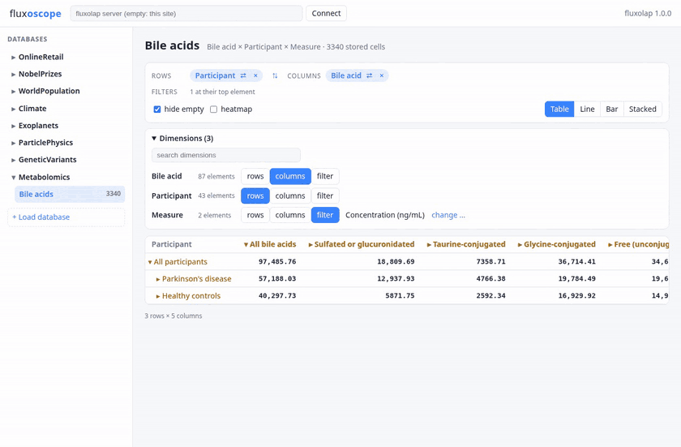
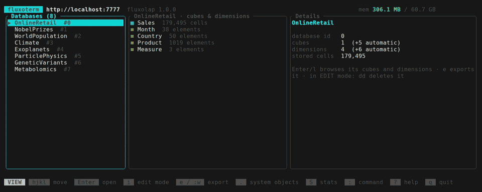
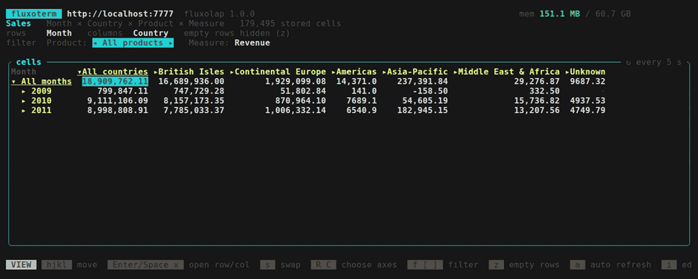
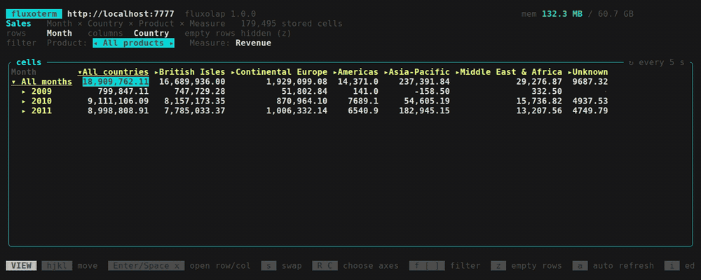

# fluxolap: every dimension

An OLAP engine in Rust that turns numbers into cubes you can slice, drill into and splash: databases, dimensions, element hierarchies with weighted consolidation, cubes, cell read/write with splashing, locks/rollback, and per-database persistence, served through a batch-first REST/JSON API. See [PLAN.md](PLAN.md) for the design and testing strategy.

Three partners ship together:

- **fluxolap**: the server and its REST API.
- **fluxoterm**: a terminal app to view, edit, load and export cubes (vim-like).
- **fluxoscope**: a web app with pivot tables and charts, served by fluxolap at <http://localhost:7777/ui>.

And for spreadsheets, **fluxolap for LibreOffice Calc**: an extension with cube formulas like `=FLUX.DATA(…)` (see [below](#fluxolap-for-libreoffice-calc)).

### See it work

The clips use the [example databases](examples/README.md) that come with fluxolap.

**fluxoscope**, the web app: a pivot table you drill into, and charts of the same view.

| | |
|---|---|
| **Climate: where CO₂ comes from.** 175 years of emissions by source, from a heatmap table to stacked, line and bar charts. |  |
| **WorldPopulation: the age structure of 10 billion people.** UN estimates and projections from 1950 to 2100, by age group. |  |
| **Exoplanets: a planet-finding boom.** Discoveries per year by detection method; the Kepler years stand out. |  |
| **NobelPrizes: a century of laureates.** Prizes per category and decade, as a table and as charts. |  |
| **Metabolomics: Parkinson's against healthy controls.** Bile acid concentrations in blood plasma, summed per bile acid group: higher in the Parkinson's samples in every group. |  |

**fluxoterm**, the terminal app (vim-like):

| | |
|---|---|
| **GeneticVariants: from chromosomes to genes.** 4.6 million variants: open a row with `Space` and a column with `x`. |  |
| **Climate: emissions over time.** Drill into Europe's countries, then move across 170 years of columns. |  |
| **OnlineRetail: splashing.** Set a new Q4 2011 revenue for Continental Europe and it spreads down to its countries in proportion to what each one sold; the totals above update. |  |
| **OnlineRetail: pivot.** Pick the dimensions for rows and columns, then swap them with `s`. |  |

## Quick start (Docker)

The image is public on GitHub's container registry, no login needed. It contains the server, fluxoterm, fluxoscope and the example databases, which it imports at startup.

```bash
docker run -p 7777:7777 ghcr.io/vherolf/fluxolap
```

Then open <http://localhost:7777/ui/> for fluxoscope or <http://localhost:7777/api/v1/docs> for the API docs. `Ctrl+C` stops it.

- **Tags.** `latest` (the default) is the newest release; every release also has its version tag, e.g. `ghcr.io/vherolf/fluxolap:v1.0.0`. `latest` changes only when you `docker pull` again. For a server that keeps data, pin a version tag, so a pull doesn't bring a new major version unnoticed.
- **Another port.** `-p 7778:7777` serves it on <http://localhost:7778/> (the second number is the port inside the container).
- **Keep your data.** Without a data folder everything is in memory and gone when the container stops:
  ```bash
  docker run -p 7777:7777 -e FLUXOLAP_DATA_DIR=/data -v "$HOME/fluxolap-data:/data" ghcr.io/vherolf/fluxolap:v1.0.0
  ```
  It saves on a normal stop (`Ctrl+C`, `docker stop`), not on `docker kill`.
- **In the background.** `docker run -d --name fluxolap -p 7777:7777 ghcr.io/vherolf/fluxolap`, then `docker logs fluxolap`, and `docker stop fluxolap` to stop it.
- **Without the examples.** Add `-e FLUXOLAP_EXAMPLES=`.
- **fluxoterm.** `docker exec -it fluxolap fluxoterm` runs the terminal client inside a container named `fluxolap`.

## Quick start (release download)

A release tarball contains `fluxolap` (the server), `fluxoterm` (the terminal viewer/editor), `ui/` (fluxoscope, the web app), `fluxolap.oxt` (the LibreOffice Calc extension), `examples/` (eight example databases), `start.sh` and this README.

Download the latest release from the [releases page](https://github.com/vherolf/fluxolap/releases/latest), or on the command line. These links always point at the newest release:

**Linux (x86_64)**

```bash
mkdir fluxolap && cd fluxolap
curl -L https://github.com/vherolf/fluxolap/releases/latest/download/fluxolap-x86_64-unknown-linux-gnu.tar.gz | tar xz
./start.sh                     # the server with the examples; prints how to connect
```

**macOS (Apple silicon)**

```bash
mkdir fluxolap && cd fluxolap
curl -L https://github.com/vherolf/fluxolap/releases/latest/download/fluxolap-aarch64-apple-darwin.tar.gz | tar xz
./start.sh                     # the server with the examples; prints how to connect
```

The LibreOffice Calc extension is also a download of its own: <https://github.com/vherolf/fluxolap/releases/latest/download/fluxolap.oxt>.

`start.sh` starts fluxolap with the example databases loaded. It prints the addresses for fluxoscope (in a browser, also from other computers on your network) and the fluxoterm command, then waits: `Ctrl+C` stops the server. `FLUXOLAP_PORT` and `FLUXOLAP_DATA_DIR` work as below. It also runs from a source checkout after `cargo build --release` (it then uses `target/release`, `target/examples` and `target/ui`).

Or start the parts yourself:

```bash
./fluxolap                     # start the server on http://localhost:7777 (FLUXOLAP_PORT=... for another port)
./fluxoterm                    # in a second terminal: browse the server; on an empty server it offers the examples
```

Then open <http://localhost:7777/ui/> in a browser for fluxoscope.

- **Web docs.** Open <http://localhost:7777/api/v1/docs> for the interactive API docs; they work offline.
- **Web app.** fluxolap serves the `ui/` folder next to its binary at `/ui` (and `/` goes there). `FLUXOLAP_UI_DIR=<dir>` serves another folder; `FLUXOLAP_UI_DIR=` (empty) turns it off. A web app hosted elsewhere needs its origin allowed with `FLUXOLAP_CORS_ORIGINS=https://its.host` (comma-separated, or `*`).
- **Load the examples at startup.** `FLUXOLAP_EXAMPLES=./examples ./fluxolap`.
- **Keep your data.** `FLUXOLAP_DATA_DIR=./data ./fluxolap` loads the databases saved in `./data` at startup and saves them on stop. Without it, the server keeps everything in memory only.
- **Stop.** `Ctrl+C` in the server's terminal, or `kill <pid>` (SIGTERM). Either one saves to `FLUXOLAP_DATA_DIR` first. `kill -9` stops without saving.
- **fluxoterm.** Starts in read-only VIEW mode; `i` switches to EDIT and `Esc` back. `:q` quits and `?` lists every key. `fluxoterm http://host:7777` connects to another server; for a remote one, tunnel over SSH: `ssh -N -L 17777:localhost:7777 user@host`, then `fluxoterm http://localhost:17777`.
- **No login.** The server has no authentication and listens on all network interfaces, so don't expose port 7777 beyond networks you trust.

## Try it with example data

fluxolap ships with eight example databases built from real open data: a UK online shop's sales, every Nobel Prize, the world's population to 2100, CO₂ emissions and the atmosphere, every known exoplanet, 100,000 particle collisions from CERN's LHC, 4.6 million human genetic variants from ClinVar, and the bile acids of people with Parkinson's disease (metabolomics). See [examples/README.md](examples/README.md) for what's in them and queries to try.

```bash
docker run -p 7777:7777 ghcr.io/vherolf/fluxolap              # imports the examples by default
FLUXOLAP_EXAMPLES=./examples ./fluxolap                       # from a release tarball
```

Then open <http://localhost:7777/api/v1/docs>, or browse from the terminal with `fluxoterm` (below).

## fluxoterm: the terminal viewer/editor

`fluxoterm` ships next to `fluxolap` (in the release tarballs and the Docker image). It shows a server's databases, cubes and dimensions, opens a cube as a grid you can drill into and edit, and imports, exports, renames and deletes databases. It talks to the server over the REST API, so it works the same against a local or a remote server.

```bash
fluxoterm                          # http://localhost:7777
fluxoterm http://olap-host:7777    # or FLUXOTERM_URL=...
fluxoterm +stats                   # start in the server statistics view (+<command> runs any : command, like vim)
docker exec -it <container> fluxoterm
```

### Vim mode

fluxoterm is modal, like vim, so you can't change a server by accident:

| Mode | How you get there | What it allows |
|---|---|---|
| **VIEW** | the default when you connect; `Esc` from EDIT | looking only: browse, open cubes and dimensions, drill down, change axes and filters, export to a file |
| **EDIT** | `i` | additionally everything that changes the server: edit and clear cells, rename, delete, clear cubes, load databases |

The bottom line always shows the mode: a grey `VIEW`, or a red `EDIT` like vim's `-- INSERT --`. In VIEW mode, a key that would change something does nothing and says "read-only in VIEW mode -- press i to edit".

**Moving** (both modes):

| Keys | Action |
|---|---|
| `h` `j` `k` `l` / arrows | left, down, up, right (in the browser, `h`/`l` switch between the panes) |
| `gg` / `G` | first / last row |
| `Ctrl-d` / `Ctrl-u` | half a page down / up |
| `Enter` | open a database, cube or dimension; in a grid in VIEW mode, drill into the row |
| `S` | the server's memory and statistics; `S` again (or `q`) goes back to where you were |
| `q` / `Esc` | back (from the browser: quit) |

**Changing things** (EDIT mode only):

| Keys | Action |
|---|---|
| `Enter` (grid) | edit the cell; at a consolidated cell the value splashes down to its base cells |
| `dd` / `Del` | grid: clear the cell. Browser: delete the selected database, cube or dimension (after asking) |
| `F2` / `n` | rename the selected database, cube or dimension |
| `c` | clear all cells of the selected cube (after asking) |
| `o` | load a database file (the examples are listed) |

**Commands**: type `:`, then the command and `Enter`. `Esc`, or `Backspace` on an empty line, cancels.

| Command | Action |
|---|---|
| `:q` | quit |
| `:w [file]` | export the current database to `file` (default `<name>.bin.zst`); allowed in VIEW mode, since it doesn't change the server |
| `:e [file]` | load a database file; without `file`, pick one from a list (EDIT mode) |
| `:r` | refresh (in a grid: reload the cells) |
| `:auto [on\|off]` | in a grid: refresh the values on their own every 5 s, or not (also `a`) |
| `:stats` | the server's memory and statistics (also `S`) |
| `:help` | show every key (also `?`) |

### Views

- **Browser.** Databases on the left; the selected database's cubes and dimensions in the middle, with cell and element counts; details on the right. It refreshes every 5 s. Automatic system/attribute objects are hidden until you press `.`.
- **Cube grid** (`Enter` on a cube). Two dimensions as rows and columns, the rest as filters on their top element.
  - Consolidated elements open with `Enter`/`Space` (row) and `x` (column).
  - `s` swaps the axes. `R`/`C` choose the dimension on rows/columns and `f` the filter to change, each from a searchable list, so cubes with a hundred dimensions and more stay manageable. `[`/`]` step through that filter's elements.
  - Only the axis dimensions' elements are loaded up front; a filter's elements load the first time you step through it. The filter line shows the focused filter and those moved off their top element, plus "+N more at their top element".
  - Rows without any value are hidden (`z` toggles).
  - It re-reads its values every 5 s, so changes made elsewhere (fluxoscope, Calc, the API, another fluxoterm) show up. That's on by default for cubes up to 1,000,000 stored cells and off for bigger ones, where every re-read costs the server more. `a` (or `:auto on|off`) switches it, the frame shows `↻ every 5 s` or `↻ off`, and `r` reads once.
  - In EDIT mode, `Enter` edits a cell (at a consolidated cell the value splashes down to its base cells) and `dd`/`Del` clears it.
  - Numbers are grouped by thousands and line up on the decimal point per column.
- **Dimension view** (`Enter` on a dimension). The element hierarchy, with each element's parents, children and weights.
- **Loading databases** (EDIT mode: `o` or `:e`). A list of the database files (`.bin.zst`) fluxoterm finds; pick one or load all at once. Files already on the server are marked. Type to filter, or type any path.
  - It looks in the server's `FLUXOLAP_EXAMPLES` folder, `examples/` next to the `fluxoterm` binary (the release tarball), the Docker image's examples, `./examples`, `./target/examples` and the current directory.
  - Connected to an **empty server**, fluxoterm opens this list by itself, so the examples are one `Enter` away.
- **Export.** `e` or `:w` saves the selected database to a file, in either mode.
- **Server statistics** (`S` or `:stats`, from any view). It updates every 2 s:
  - **Server:** version, uptime, pid and CPUs, where databases are saved.
  - **Memory:** the server's resident memory (RSS) as a bar against its limit. The limit is the container's (cgroup) limit, or else the machine's memory. The panel also shows the peak, the estimated memory of the stored cells, the memory still available, and a sparkline.
  - **Requests:** requests per second, average latency, totals, client/server errors, and a sparkline. fluxoterm's own polling of the statistics isn't counted.
  - **Databases & cubes by memory:** each database and its cubes, largest first, with dimensions, cells (in the hot/write and cold/compressed tiers), locks, estimated memory and its share. `Enter` opens that cube (or database) in the browser, `.` shows the automatic cubes too, and `r` reads the statistics now.
  - **Header:** in every view, the header shows `mem <RSS> / <limit>`, turning yellow from 75 % and red from 90 %.
  - **Older servers:** a server older than fluxolap 21 has no statistics; fluxoterm then just leaves them out.
- `?` shows every key.

## fluxolap for LibreOffice Calc

`fluxolap.oxt` is a LibreOffice extension that brings cubes into spreadsheets as formulas: install it with Tools → Extension Manager. It's in the release tarballs and is its own download; build it with `python3 clients/libreoffice/build.py`.

```
=FLUX.DATA("localhost:7777"; "WorldPopulation"; "Population"; "World"; 1950; "Both sexes"; "All ages")
{=FLUX.AREA("localhost:7777"; "WorldPopulation"; "Population"; B2:B4; C1:E1; "Both sexes"; "All ages")}
{=FLUX.ELEMENTS("localhost:7777"; "NobelPrizes"; "Category")}
```

It reads by name, shows problems as `#FLUX: …` in the cell, and batches: after the first calculation, a sheet's formulas are re-read in one request (Ctrl+Shift+F9). A **fluxolap menu** builds reports for you (*Paste view*: pick a cube, rows, columns and filters), loads databases, and refreshes. In a pasted view, **double-click** a total to open or close it, a filter to pick another element, or the title to change the view. **Writing back:** type a value over a `FLUX.DATA` cell. It goes to the server (a total splashes down to its base cells), and the formula stays and shows the new value. Details, including a pitfall with Python virtualenvs, are in [clients/libreoffice/README.md](clients/libreoffice/README.md).

## fluxoscope: the web app

fluxoscope is fluxolap's web app for exploring and charting cubes. It is written in Rust with [Leptos](https://leptos.dev) and compiled to WebAssembly, so the only JavaScript is the generated glue. Like fluxoterm, it uses the REST API and the server's own request/response types (`fluxolap-api-types`). fluxolap serves it at <http://localhost:7777/ui>; the release tarballs and the Docker image include it.

- **Databases and cubes** are listed on the left, each cube with its cell count.
- **Loading databases** ("+ Load database" in the sidebar). The server's example databases, each with "Load", plus "Load all"; or database files (`.bin.zst`) uploaded from your computer. Connected to an **empty server**, fluxoscope opens this page by itself, like fluxoterm.
  - The server offers the files in `FLUXOLAP_EXAMPLES`, `examples/` next to the `fluxolap` binary (the release tarball), the Docker image's examples and `target/examples` (a source checkout).
- **Pivot table.** Rows and columns can each hold several nested dimensions; every other dimension is a filter set to one element. Click a consolidated element to open it, and click again to close it. Empty rows and columns are hidden (toggle).
- **Many dimensions.** A cube with 100+ dimensions stays usable. The dimension panel is searchable and collapses dimensions still at their top element. Element lists load only when needed (just the top-level elements for filters).
- **Big, sparse views.** With “hide empty” on, a view may read up to 200,000 cells; the server sends only the ones with a value. The table draws just the rows in view, so thousands of rows scroll smoothly (at most 500 columns). Without “hide empty”, a view reads at most 40,000 cells. Views over 40,000 cells aren't re-read in the background, since that would keep the server busy.
- **Charts** of the same view: line (scaled to the data's range), bar and stacked bar (from 0, opened totals left out so nothing is counted twice). Click a legend entry to open that element.
- **Links.** The view lives in the URL, so you can bookmark it or send it on.
- **Another server.** Enter its address in the header. A server on another origin needs `FLUXOLAP_CORS_ORIGINS` set to fluxoscope's origin.

### How it works

```
browser                                    fluxolap (one process, port 7777)
┌──────────────────────────────┐   GET /ui/…     ┌──────────────────────────────┐
│ fluxoscope (WebAssembly)     │ ──────────────▶ │ static files from ui/        │
│  pivot model, charts (SVG)   │                 │  (index.html, .wasm, .css)   │
│                              │   /api/v1/…     │                              │
│  typed REST client           │ ◀─────────────▶ │ REST API → engine → cubes    │
└──────────────────────────────┘      JSON       └──────────────────────────────┘
```

1. **Loading.** Opening <http://localhost:7777/> redirects to `/ui/`. fluxolap sends `index.html`, which loads the `.wasm` file (about 440 KB). From then on everything runs in the browser, and fluxoscope has no server of its own.
2. **Talking to fluxolap.** fluxoscope calls the same REST API as fluxoterm and `curl`, on the page's own origin, so no CORS setup is needed:
   - `GET /api/v1/databases`, then the database's dimensions and cubes;
   - to load a database: `GET /api/v1/examples` lists the server's example files, and `POST /api/v1/examples/{file}/import` imports one. A browser can't read the server's disk, so the server does. An upload from your computer is `POST /api/v1/databases/import`;
   - element lists per dimension: just the top level (`?roots=true`) for filters, the full list once a dimension goes on rows or columns;
   - one `POST …/cells/query` per view with an *area*: one element list per dimension, read as their cartesian product. The server sums the consolidated cells in a single pass.
3. **Rendering.** The pivot model (nesting, drill, zero suppression, number formatting) and the chart scales are plain Rust in `src/model`. Leptos turns them into the table and SVG charts. A drill or a new filter changes the view, and only its cells are fetched again.
4. **The address.** Everything that differs from the default view is written to the URL's `#…` part. Opening that link restores the view.

Apart from loading databases, fluxoscope only reads data; to change cells, rename, delete or export databases, use fluxoterm or the API.

### Developing fluxoscope

It needs the `wasm32-unknown-unknown` target and [trunk](https://trunkrs.dev):

```bash
rustup target add wasm32-unknown-unknown
cargo install trunk --locked
cd crates/fluxoscope
trunk serve                     # http://localhost:8080, /api proxied to a fluxolap on :7777
trunk build --release --cargo-profile wasm-release --dist ../../target/ui   # what the release ships
FLUXOLAP_UI_DIR=target/ui cargo run -p fluxolap-server                     # serve that build at /ui
```

The table, drill-down, formatting and chart logic lives in `src/model` and is tested on the host: `cargo test -p fluxoscope`.

## Status

1.0 is the first public release: the engine (hierarchies, consolidation, splashing, locks, per-database persistence), the REST API under `/api/v1`, and three clients (fluxoterm, fluxoscope, fluxolap for Calc). There is no rule/formula language and no authentication (see [Security](#security)).

## Prerequisites

- A Rust toolchain (cargo + rustc). If not installed:
  ```bash
  sudo apt-get install -y cargo rustc
  ```
  (or use [rustup](https://rustup.rs/) for a newer/managed toolchain)

## Build

From the repo root:

```bash
cargo build
```

This builds every crate in the workspace, including the `fluxolap` binary (`crates/fluxolap-server`).

## Run

```bash
cargo run --release -p fluxolap-server
```

Listens on `0.0.0.0:7777`; override with `FLUXOLAP_PORT`. `FLUXOLAP_EXAMPLES=<dir>` imports the example databases in `<dir>` at startup (build them with `cargo run --release -p xtask -- examples`, which writes `target/examples`). Open `http://localhost:7777/`, which redirects to the interactive API docs (Swagger UI) at `/api/v1/docs`. The docs are served from the binary itself and work offline. The OpenAPI spec is at `/api/v1/openapi.json`.

### Security

fluxolap has **no authentication**: anyone who can reach its port can read, change and delete every database. It listens on all network interfaces (`0.0.0.0:7777`), so:
- run it on your own machine or a trusted network, or behind a firewall;
- to offer it to others, put a reverse proxy in front that handles TLS and logins (fluxolap speaks plain HTTP);
- cross-origin browser requests are off by default; `FLUXOLAP_CORS_ORIGINS` allows specific origins (or `*`).

### Persistence

By default the server is fully in-memory. Set `FLUXOLAP_DATA_DIR` to opt into persistence: at startup the server loads the database registry (`registry.bin.zst`) and every registered database file from that directory. A clean stop (Ctrl+C/SIGINT, or SIGTERM from a process manager) saves every loaded database and the registry back before the process exits. A hard kill (`kill -9`) does **not** save.

```bash
FLUXOLAP_DATA_DIR=/var/lib/fluxolap cargo run --release -p fluxolap-server
```

## REST API

### Conventions

- **Resources** nest by id: `/api/v1/databases/{db}/dimensions/{dim}/elements/{el}` and `/api/v1/databases/{db}/cubes/{cube}/cells`, `.../locks/{lock}`.
- **Methods**: `GET` reads, `POST` on a collection creates (**201** with a `Location` header), `PATCH` updates, `DELETE` deletes (**204**).
- **Lists** return `{"items": [...], "total": n}` and take `limit`/`offset` plus filters (`name`, `type`, ...).
- **References**: wherever a request refers to an element or dimension, give its id (`3`) or its name (`"North"`).
- **Types** are lowercase strings: dimension/cube `normal`/`system`/`attribute`/`user_info`, element `numeric`/`string`/`consolidated`.
- **Cell values** are JSON numbers or strings; `null` means empty. Writing `null` clears a cell.
- **Errors** are [RFC 9457](https://www.rfc-editor.org/rfc/rfc9457) problem details (`application/problem+json`): `status`, `title`, `detail`, a machine-readable `code` (`database_not_found`, `element_name_in_use`, ...), a numeric `error_code`, and for batch requests the `index` of the failing item. 400 means the request couldn't be parsed, 404 a missing resource, 409 a clash with existing state, and 422 a request that parsed but can't be carried out.

### Endpoints

| Resource | Methods |
|---|---|
| `/api/v1` | `GET` server name/version |
| `/stats` | `GET` memory (the process's RSS, peak, container limit, the machine's memory; estimated memory per database and cube), request counters and contents totals. On Linux, everything is reported; elsewhere, only the RSS |
| `/databases` | `GET` list, `POST` create |
| `/databases/{db}` | `GET`, `PATCH` rename, `DELETE` |
| `/databases/import` | `POST` a database file (`application/octet-stream`); 409 if the name exists |
| `/databases/{db}/export` | `GET` the database as a file (`.bin.zst`) |
| `/examples` | `GET` the example database files the server offers (name, size, already loaded?) |
| `/examples/{file}/import` | `POST` import one of them; 409 if the name exists |
| `/databases/{db}/dimensions` | `GET` list, `POST` create |
| `/databases/{db}/dimensions/{dim}` | `GET`, `PATCH` rename, `DELETE` (409 while a cube uses it) |
| `/databases/{db}/dimensions/{dim}/elements` | `GET` list (`?roots=true`: top-level elements only); batch `POST` create, `PUT` upsert by name, `PATCH` update; `DELETE ?all=true` clears |
| `/databases/{db}/dimensions/{dim}/elements/delete` | `POST` batch delete |
| `/databases/{db}/dimensions/{dim}/elements/{el}` | `GET`, `PATCH`, `DELETE` |
| `/databases/{db}/cubes` | `GET` list, `POST` create |
| `/databases/{db}/cubes/{cube}` | `GET`, `PATCH` rename, `DELETE` |
| `/databases/{db}/cubes/{cube}/cells` | `GET` page through stored cells; `PUT` batch write; `DELETE` clear all |
| `/databases/{db}/cubes/{cube}/cells/query` | `POST` batch read (`paths` or `area`); `"skip_empty": true` leaves out cells without a value (a sparse area comes back small) |
| `/databases/{db}/cubes/{cube}/cells/{path}` | `GET`, `PUT` one cell; `path` like `3,17` or `North,Jan` |
| `/databases/{db}/cubes/{cube}/locks` | `GET` list, `POST` lock an area (or the whole cube) |
| `/databases/{db}/cubes/{cube}/locks/{lock}` | `GET`; `POST .../commit`, `POST .../rollback?steps=n` |

All paths above are under `/api/v1`.

### Batch operations

Elements and cells are loaded in batches: one request carries up to hundreds of thousands of items (bodies up to 512 MB).

- **Element batches are all-or-nothing.** They run against a copy of the dimension, which replaces the original only if every item succeeds. A failure reports the item's `index` and changes nothing. Children may name elements created elsewhere in the same batch, so a whole hierarchy loads in one request.
- **`PUT .../elements` upserts by name** and is idempotent, so re-sending the same dimension is harmless. An existing element takes the item's `type`, `children` (when given) replace its child list, and omitted `children` are kept.
- **Deleting elements clears their cells** in every cube that uses the dimension, so no cell is left pointing at a deleted element.
- **Cell writes apply in order.** Consecutive base-cell writes are stored in one storage call. A path with a consolidated element splashes the value down to its base cells, and `null` there clears them. Every path is validated before anything is written. The one exception is a splash refused for being too large (422 with `index`), which leaves the items before it written.

```bash
API=http://localhost:7777/api/v1
curl -s -X POST $API/databases -H 'content-type: application/json' -d '{"name": "Sales"}'
# -> 201 {"id":0,"name":"Sales","type":"normal"}   Location: /api/v1/databases/0

curl -s -X POST $API/databases/0/dimensions -H 'content-type: application/json' -d '{"name": "Region"}'
# -> 201 {"id":2,"name":"Region","type":"normal","element_count":0,"modified":1792310400}
#    ("modified": when the dimension last changed -- created, renamed, elements or consolidations
#    changed -- in seconds since the Unix epoch; null if last changed by a version that didn't record it)
#    (ids 0/1 are the automatic #_DIMENSION_ system dimension and its attribute dimension)

# A whole hierarchy in one request -- Total's children are created in the same batch.
curl -s -X POST $API/databases/0/dimensions/2/elements -H 'content-type: application/json' -d '{"items": [
  {"name": "Total", "children": [{"element": "North"}, {"element": "South", "weight": 2}]},
  {"name": "North"}, {"name": "South"}]}'

curl -s -X POST $API/databases/0/dimensions -H 'content-type: application/json' -d '{"name": "Month"}'
curl -s -X PUT $API/databases/0/dimensions/4/elements -H 'content-type: application/json' -d '{"items": [
  {"name": "Jan"}, {"name": "Feb"}, {"name": "Q1", "children": [{"element": "Jan"}, {"element": "Feb"}]}]}'

curl -s -X POST $API/databases/0/cubes -H 'content-type: application/json' -d '{"name": "Revenue", "dimensions": ["Region", "Month"]}'
# -> 201 {"id":3,"name":"Revenue","type":"normal","dimensions":[2,4],"cell_count":0,"modified":null}
#    ("modified": when the cube's cells last changed, in seconds since the Unix epoch; null until the first write)
#    (cubes 0-2 are the automatic attribute cubes of #_DIMENSION_, Region and Month)

# Batch write: two base cells, then a splash of 30 into the empty Total/Feb.
curl -s -X PUT $API/databases/0/cubes/3/cells -H 'content-type: application/json' -d '{"items": [
  {"path": ["North", "Jan"], "value": 10},
  {"path": ["South", "Jan"], "value": 5},
  {"path": ["Total", "Feb"], "value": 30}]}'

# Batch read of an area (cartesian product), consolidated coordinates aggregated.
curl -s -X POST $API/databases/0/cubes/3/cells/query -H 'content-type: application/json' -d '{"area": [["North", "South", "Total"], ["Jan", "Q1"]]}'
# -> {"items":[{"path":[1,0],"value":10.0},{"path":[1,2],"value":20.0},{"path":[2,0],"value":5.0},
#              {"path":[2,2],"value":15.0},{"path":[0,0],"value":20.0},{"path":[0,2],"value":50.0}],"total":6}

curl -s $API/databases/0/cubes/3/cells/Total,Q1
# -> {"path":[0,2],"value":50.0}
```

Measured on a release build, one request each, over HTTP on localhost (Python client):

| Operation | Time |
|---|---|
| Create 100,001 elements (one consolidated over the other 100,000) | 0.29 s |
| Re-upsert the same 100,001 elements (`PUT`) | 0.30 s |
| Rename 100,000 elements (`PATCH`) | 0.24 s |
| Write 1,000,000 base cells (`PUT`) | 0.99 s |
| Read 100,000 base cells (`POST .../query`) | 0.08 s |
| Delete 50,000 elements, clearing their 500,000 cells | 0.48 s |


## Test

```bash
cargo test                                    # unit, property, engine and REST API integration tests
```

`crates/fluxolap-api/tests/api.rs` runs the API end to end over real HTTP.

### Dev benchmarks (`xtask`)

```bash
cargo run --release -p xtask -- membench [cells dims]    # fluxolap-storage bytes/cell
cargo run --release -p xtask -- writebench [cells dims]  # per-cell write classification cost
cargo run --release -p xtask -- examples [out_dir]       # build the example databases (default target/examples)
```

## Layout

See [PLAN.md](PLAN.md#architecture) for the full crate-by-crate rationale.

- `crates/fluxolap-domain`: server domain state (databases, dimensions, elements, cubes), no I/O, no auth
- `crates/fluxolap-storage`: cube cell storage (sharded per cube, hot/cold tiers)
- `crates/fluxolap-error`: the error model (`ErrorCode`, `FluxolapError`)
- `crates/fluxolap-engine`: `AppState` + per-database persistence (`state`), business logic including batch cell read/write (`ops`), dimension create/rename/destroy with system/attribute provisioning (`provision`)
- `crates/fluxolap-api`: the REST API (axum handlers, problem details, OpenAPI spec, embedded Swagger UI)
- `crates/fluxolap-api-types`: the API's request/response types, shared by the server and clients
- `crates/fluxoterm`: the terminal viewer/editor
- `crates/fluxoscope`: the web app (Leptos, WebAssembly)
- `clients/libreoffice`: the LibreOffice Calc extension (Python)
- `crates/fluxolap-examples`: builds the example databases from `examples/sources`
- `crates/fluxolap-server`: the `fluxolap` binary
- `xtask`: dev benchmarks and diagnostics, and the example-database build
- `examples/`: the example datasets' source packages and fetch scripts

## Authors

fluxolap is developed by Vherolf and Christian Schwarzinger, as equal authors.

## Acknowledgments

See [ACKNOWLEDGMENTS.md](ACKNOWLEDGMENTS.md) for the sources of the example data.

## License

Licensed under either of [Apache License, Version 2.0](LICENSE-APACHE) or [MIT license](LICENSE-MIT) at your option.

Unless you explicitly state otherwise, any contribution intentionally submitted for inclusion in this project, as defined in the Apache-2.0 license, shall be dual-licensed as above, without any additional terms or conditions.
